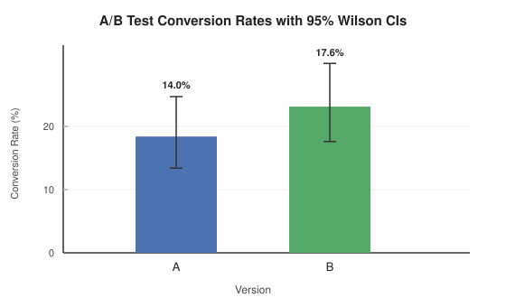

# Python A/B Testing Analysis

[](https://github.com/folasunkanmi/python-ab-testing/actions/workflows/ci.yml)
[](https://www.python.org/)
[](LICENSE)
[](#reproducibility)

**Statistical evaluation of an A/B test comparing two product versions on conversion rate.**

**Author:** Folasunkanmi  
**Repository:** https://github.com/folasunkanmi/python-ab-testing

---

## Conversion Rate Summary



| Version | Conversion Rate | 95% Wilson CI |
|---------|-----------------|---------------|
| **A**   | 14.0%           | [10.2%, 18.8%] |
| **B**   | 17.6%           | [13.4%, 22.8%] |

Absolute difference: **+3.6 pp** · Relative lift: **+25.7%** · Two-proportion z-test *p* = **0.270** (not significant)

---

## Abstract

This project delivers a complete, reproducible A/B test analysis that includes:

- **Strict data validation** that stops the analysis when invalid records are found
- **Sample Ratio Mismatch (SRM)** test against the expected 50/50 allocation
- Conversion rates with **95% Wilson confidence intervals**
- **Two-proportion z-test** as the primary hypothesis test
- Effect size (Cohen’s *h*)
- **Power analysis** and required sample-size calculations
- Visualizations that show uncertainty
- Clear **business recommendations**
- **Automated tests** and **GitHub Actions CI** (including notebook execution)

**Key result:** Version B converted higher in the sample, but the difference is **not statistically significant**. The experiment was underpowered (~20% power).

---

## Data Provenance (Important)

The dataset (`ab_data.csv`) was supplied as an exercise / example file.  

**Its original source, collection method, time period, product context, and any filtering or cleaning steps are unknown.**  

Treat all numerical results as **illustrative**. Do not interpret them as evidence about any real product or user population without independent verification of the data’s origin and quality.

---

## Project Structure

```
python-ab-testing/
├── AB_Test_Analysis.ipynb      # Analysis notebook (with outputs)
├── ab_data.csv                 # Experimental data (500 users)
├── conversion_rates_ci.svg     # Chart used in this README
├── requirements.txt
├── LICENSE
├── README.md
├── tests/
│   └── test_ab_analysis.py     # Automated tests
└── .github/workflows/
    └── ci.yml                  # GitHub Actions CI
```

---

## Quick Start

```bash
git clone https://github.com/folasunkanmi/python-ab-testing.git
cd python-ab-testing
pip install -r requirements.txt
pytest tests/ -v                  # run automated tests
jupyter lab AB_Test_Analysis.ipynb
```

---

## Methodology Highlights

1. **Strict validation** – Missing values, duplicates, invalid labels, or schema problems raise an error and stop the analysis.
2. **SRM check** – Chi-square goodness-of-fit against a 50/50 split (flag at *p* < 0.001).
3. **Confidence intervals** – Wilson score intervals for rates; Wald interval for the difference.
4. **Primary test** – Two-proportion z-test.
5. **Effect size** – Cohen’s *h*.
6. **Power analysis** – Achieved power + required *n* for 5–25% relative lifts.
7. **Business translation** – Explicit go / no-go recommendation and design guidance for the next experiment.

---

## Business Recommendation

**Do not fully roll out Version B** on the basis of this test alone.

| Priority | Action |
|----------|--------|
| High | Keep Version A (or current experience) as default |
| High | Re-run with a larger sample (see power table in notebook) |
| Medium | Examine secondary metrics and segments |
| Low | Consider sequential testing frameworks for future experiments |

To detect a **10% relative lift** with 80% power (α = 0.05) you need approximately **8,000–9,000 users per group**.

---

## Continuous Integration

Every push and pull request to `main` runs:

- `pytest` across Python 3.10, 3.11 and 3.12
- Notebook JSON validity check
- **Full notebook execution** via `nbconvert` / `jupyter execute`

See the Actions tab for status.

---

## How to Cite

```
Folasunkanmi. (2026). A/B Test Analysis: Conversion Rate Comparison 
[Jupyter Notebook]. GitHub. https://github.com/folasunkanmi/python-ab-testing
```

---

## Reproducibility Checklist

- [x] Raw data included
- [x] Strict validation with early stop on invalid records
- [x] Sample Ratio Mismatch (SRM) test
- [x] Confidence intervals reported
- [x] Primary two-proportion z-test
- [x] Power analysis
- [x] Business recommendations
- [x] Automated tests
- [x] GitHub Actions CI (including notebook execution)
- [x] Notebook saved with outputs
- [x] Honest documentation of unknown data provenance
- [x] MIT License

---

## License

MIT License – free to use, modify, and distribute with attribution.
